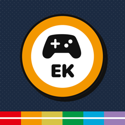
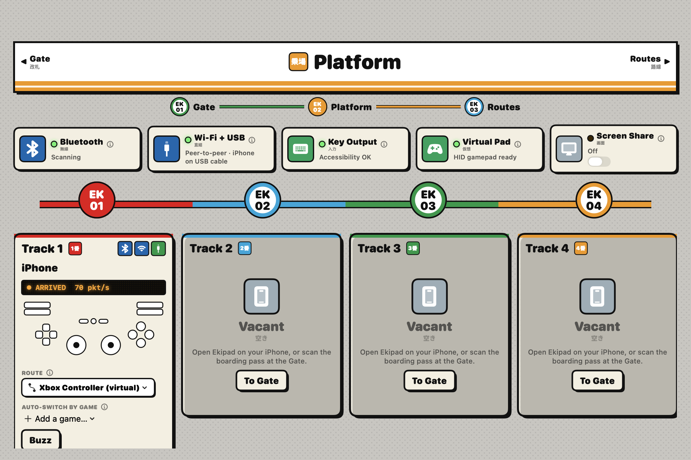
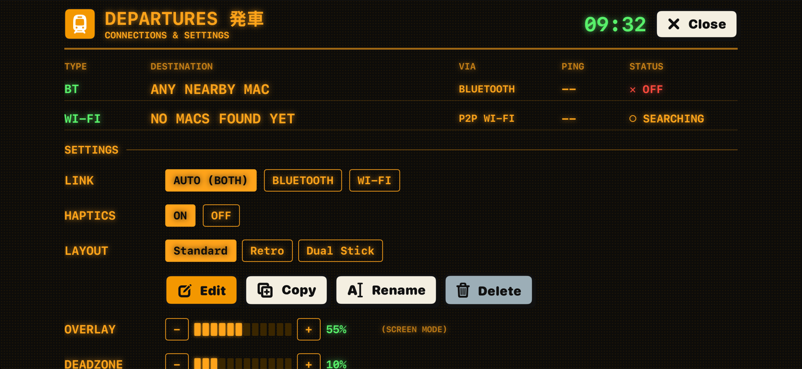
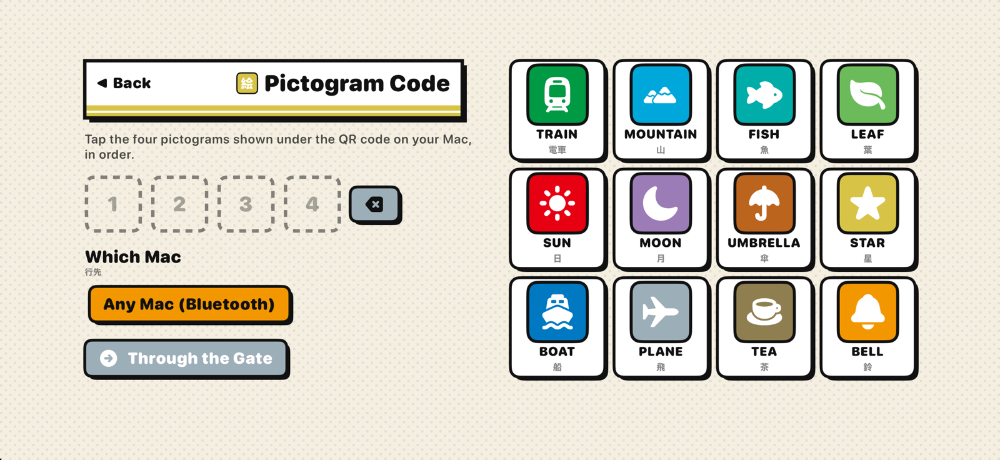

<p align="center"></p>

<h1 align="center">Ekipad 駅</h1>

<p align="center"><b>Turn your iPhone into a game controller for your Mac.</b><br>
Shows up on your Mac as an Xbox controller · Bluetooth and peer-to-peer Wi-Fi at the same time · no router needed</p>

<p align="center"></p>

> **Status:** early development. v0.1 runs on a real iPhone and Mac, and the virtual Xbox controller works in games.
> Source code isn't public yet. This repo has the project overview, roadmap and updates.
> Questions and ideas are welcome in [Issues](../../issues).

---

## The goal

Play anything on your Mac (Steam games, emulators, native ports, CrossOver/Whisky wrappers) with the phone
already in your pocket, **as if it were a normal Bluetooth gamepad**. It should be:

- **Seamless:** pair once, then it connects by itself.
- **Wireless without Wi-Fi:** works on a plane, in a hotel, anywhere. No router, no hotspot.
- **Yours:** a fully customizable layout that fits every iPhone cleanly.
- **Fun to use:** a design inspired by Japanese transit signage and 1990s consoles.

## Features (v0.1)

| | |
|---|---|
| 🎮 **Full controller** | Two analog sticks, 8-way D-pad, A/B/X/Y, L1/R1/L2/R2, L3/R3, Start/Select/Home, real multi-touch with slide-between-buttons, haptics |
| 📡 **Dual link** | Every input goes over **Bluetooth LE and peer-to-peer Wi-Fi at once**. The Mac keeps whichever copy arrives first, so if one link drops, play continues on the other |
| ✈️ **No network needed** | Peer-to-peer Wi-Fi is the same radio AirDrop uses. Wi-Fi only has to be switched on, not connected |
| 🔳 **Three ways to pair** | Scan a QR code with the iPhone Camera · tap a 4-pictogram code (TRAIN · MOUNTAIN · FISH …) · or just let the phone wait at the Mac's "ticket gate" and click Allow |
| ✏️ **Layout editor** | Drag, resize, hide and fade any control. Snaps to a grid and stays inside the safe area of every iPhone. Presets: Standard, Retro, Dual Stick |
| 🕹️ **Virtual Xbox controller** | Your Mac sees a real Xbox Wireless Controller, so Steam, SDL games, native ports and Apple's game controller support just work. Game rumble buzzes the phone. One controller per phone |
| ⌨️ **Routes** | Map the pad to keyboard and mouse per game: built-ins for emulators, PC-style WASD + mouse look, mouse mode, and native Switch ports. Rebind anything in one click |
| 🖥️ **Screen sharing** | Flip to Screen mode at any time to see the Mac on the phone (low-latency H.264), with your controls overlaid, or use the phone as a touchpad |
| 👥 **Up to 4 players** | Each phone gets its own track (EK 01–04) and its own route |

<p align="center">


</p>
<p align="center">


</p>
<p align="center"></p>

## How it works

```
 iPhone · Ekipad                                  Mac · Ekipad Host
 ┌──────────────────────┐   Bluetooth LE          ┌───────────────────────────┐
 │ touch controls       │ ──────────────────────▶ │ merges both links,        │──▶ keyboard & mouse (today)
 │ layout editor        │   peer-to-peer Wi-Fi    │ drops duplicates,         │──▶ virtual Xbox controller
 │ screen view          │ ──────────────────────▶ │ players 1–4               │
 └──────────────────────┘ ◀── screen (H.264) ──── └───────────────────────────┘
```

**Why does the Mac need an app?** iOS doesn't let apps pretend to be a Bluetooth controller, so the phone can't
pair with the Mac like a real gamepad. Ekipad Host receives the input and presents it to macOS as a virtual Xbox
controller (or as keyboard and mouse, for games without controller support).

## What works with what

| | Keyboard/mouse routes | Virtual Xbox controller |
|---|---|---|
| Emulators (RetroArch, OpenEmu, Dolphin…) | ✅ | ✅ |
| Native Switch ports | ✅ keyboard player | ✅ as a controller |
| Games with keyboard controls | ✅ one route per game | ✅ |
| Gamepad-only games, Steam Input, Apple Arcade | ❌ | ✅ |

## Roadmap

**v0.1 (prototype): done**
- [x] iPhone controller app with multi-touch controls and haptics
- [x] Mac host app (window + menu bar) with up to 4 players
- [x] Bluetooth LE + peer-to-peer Wi-Fi dual link, no router needed
- [x] Pairing by QR code, pictogram code, or approval at the gate
- [x] Customizable layouts with presets
- [x] Keyboard/mouse routes and a route editor, including a Switch-port preset
- [x] Screen sharing with controls overlaid, plus a touchpad mode

**v0.2: done**
- [x] **Virtual Xbox controller on the Mac.** Steam, SDL games and macOS see a real controller, and game rumble buzzes the phone
- [x] Runs on a real iPhone and Mac

**Next**
- [ ] **Ekipad Dongle.** A ~$10 ESP32-S3 board that shows up as a genuine Bluetooth/USB gamepad, for other devices and for using it without the Mac app.
- [ ] Real-device tuning: Bluetooth latency, haptics, multi-touch feel
- [ ] Automatic per-game routes (switch when a game comes to the front)
- [ ] Motion/gyro aiming
- [ ] Layout import/export and sharing; iPad support
- [ ] TestFlight beta and a notarized Mac build

**Later**
- [ ] Decide on open-sourcing

## Privacy

Everything stays between your iPhone and your Mac: no accounts, no cloud, no analytics. Screen sharing only goes to
phones you've paired and that are currently connected, and you can turn it off on the Mac.

## Design

Japanese public-transit signage meets 1990s consoles: English first with kanji accents, pictograms for
everything, station-number badges for players, a station-name sign for navigation, an amber LED departure board
for settings, thick outlines and hard shadows.

---

<sub>© Ekipad. All rights reserved. Source code isn't licensed for reuse at this time. Not affiliated with Apple,
Microsoft, Nintendo or Valve; product names belong to their owners.</sub>
