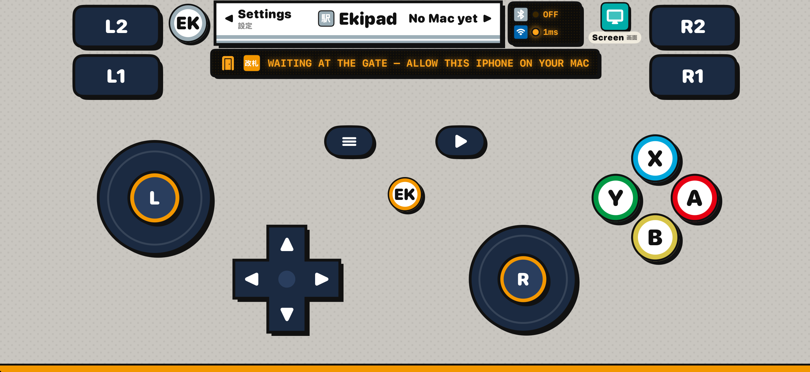
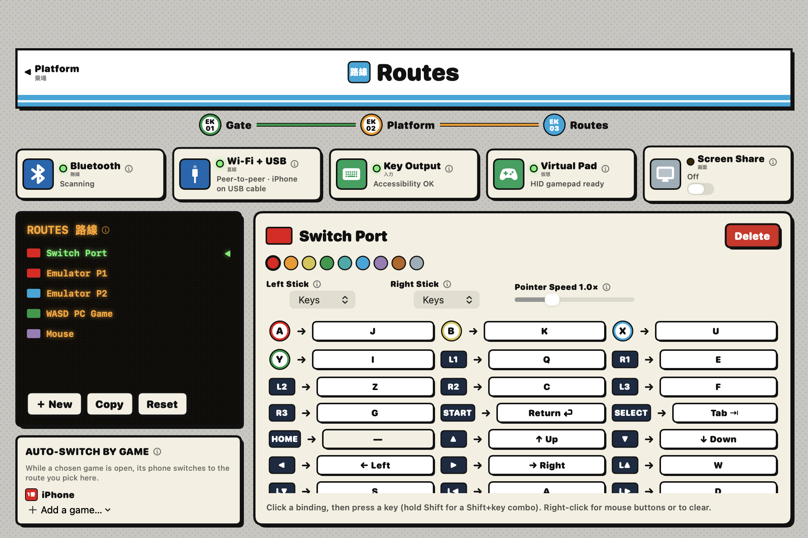
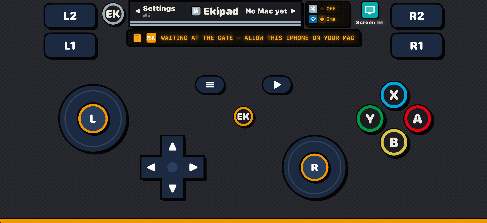
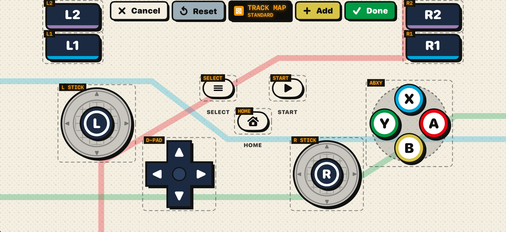

<p align="center"></p>

<h1 align="center">Ekipad 駅</h1>

<p align="center"><b>Turn your iPhone into a game controller for your Mac.</b><br>
Shows up as an Xbox controller · Bluetooth, peer-to-peer Wi-Fi and USB at the same time · no router needed</p>

<p align="center"></p>

## Download

| | |
|---|---|
| **Mac: Ekipad Host 1.3** (free, required) | **[Download the latest release](https://github.com/RedfernsOutpost/ekipad/releases/latest)** (`Ekipad-Host-1.3.zip` or `.dmg`). macOS 14 or later; the virtual game controller needs macOS 15. Signed with Developer ID and notarized by Apple. |
| **iPhone: Ekipad** | [Get it on the App Store](https://apps.apple.com/app/id6838139422). |

Setup takes a minute: open Ekipad Host, allow Key Output (Accessibility) when asked, open Ekipad on your iPhone and
click **Allow** at the Gate. The built-in tour walks you through it.

📖 **[User guide (Wiki)](https://github.com/RedfernsOutpost/ekipad/wiki)**: pairing, connections, routes, layouts,
the Mouse layout, gyro aiming, every setting, and troubleshooting. Questions or problems:
[open an issue](https://github.com/RedfernsOutpost/ekipad/issues).

> **Status:** early development (v0.3). Runs on a real iPhone and Mac, and the virtual Xbox controller works in games.
> Source code isn't public yet. This repo has the project overview, roadmap and updates.
> Questions and ideas are welcome in [Issues](../../issues).

---

## The goal

Play anything on your Mac (Steam games, emulators, native ports, CrossOver/Whisky wrappers) with the phone
already in your pocket, **as if it were a normal gamepad**. It should be:

- **Seamless:** pair once, then it connects by itself.
- **Wireless without Wi-Fi:** works on a plane, in a hotel, anywhere. No router, no hotspot. Or plug in a cable.
- **Yours:** a fully customizable layout that fits every iPhone cleanly.
- **Fun to use:** a design inspired by Japanese transit signage and 1990s consoles.

## Features

| | |
|---|---|
| 🕹️ **Virtual Xbox controller** | Your Mac sees a real Xbox Wireless Controller, so Steam, SDL games, native ports and Apple's game controller support just work. Game rumble buzzes the phone. One controller per phone |
| 🎮 **Full controller** | Two analog sticks with stick click (double-tap and hold for L3/R3), 8-way D-pad, A/B/X/Y, L1/R1/L2/R2, Start/Select/Home, real multi-touch with slide-between-buttons, haptics |
| 🎯 **Gyro aiming** | Tilt the phone to aim, on the right stick or as mouse movement. Aim always, while your thumb is on the right stick, or while holding L2 |
| 📡 **Triple link** | Every input goes over **Bluetooth LE, peer-to-peer Wi-Fi and the USB cable at once**. The Mac keeps whichever copy arrives first, so if one link drops, play continues on the others |
| 🔌 **USB cable** | Plug the iPhone into the Mac for the lowest latency. No Personal Hotspot or network needed |
| ✈️ **No network needed** | Peer-to-peer Wi-Fi is the same radio AirDrop uses. Wi-Fi only has to be switched on, not connected |
| 🔐 **Secure pairing** | Each phone and Mac has its own key. Every connection starts with a challenge, input is signed, and the QR code carries the Mac's key, so nobody nearby can pretend to be your phone or your Mac |
| 🔳 **Three ways to pair** | Scan a QR code with the iPhone Camera · tap a 4-pictogram code (TRAIN · MOUNTAIN · FISH …) · or just let the phone wait at the Mac's "ticket gate" and click Allow |
| ✏️ **Layout editor** | Drag, resize, hide and fade any control, or split A/B/X/Y into separate buttons. Snaps to a grid and stays inside the safe area of every iPhone. Presets: Standard, Retro, Dual Stick |
| ⌨️ **Routes** | Map the pad to keyboard and mouse for games without controller support: built-ins for emulators, PC-style WASD + mouse look, mouse mode and native Switch ports. Rebind anything in one click |
| 🔀 **Auto-switch by game** | Tell each phone which route to use per game (e.g. *this port → Xbox controller, RetroArch → Emulator P1*). It switches by itself when that game comes to the front |
| 🖥️ **Screen sharing** | Flip to Screen mode at any time to see the Mac on the phone (low-latency H.264), with your controls overlaid, or use the phone as a touchpad |
| 🌙 **Light & dark** | Both apps follow your system or stay light or dark. Dark mode is the station after hours |
| 👥 **Up to 4 players** | Each phone gets its own track (EK 01–04), player colour and route |
| 🚉 **Guided tour** | Both apps open with a short tour, a ride along a line of stops, that explains pairing, what each phone controls, routes and auto-switch. Replay it anytime |
| ⓘ **Built-in help** | Tap any title for a short explanation of what it does |

<p align="center">


</p>
<p align="center">


</p>
<p align="center">


</p>

## Getting started

Both apps greet you with a short tour the first time you open them, drawn as a train line with one station per
step:

| Mac (Ekipad Host) | iPhone (Ekipad) |
|---|---|
| **Welcome** · what Ekipad does | **Welcome aboard** · open Ekipad Host on the Mac |
| **Gate** · pair a phone: click Allow, scan the QR code, or tap the 4 pictograms | **Connecting** · finds the Mac by itself; pair once by Allow, QR or pictograms |
| **Platform** · each phone's track and what it controls | **Make it yours** · edit, resize, hide or split buttons; double-tap a stick for L3/R3 |
| **Routes** · a route is a control profile, e.g. a Zelda route | **Handy extras** · screen mode, gyro aiming, ⓘ help |
| **Auto-switch** · link a game to a route | |
| **One permission** · allow Key Output, right from the tour | |

Replay it from **Help → Ekipad Tour** on the Mac or **Settings → Device → Show tour** on the iPhone.

## How it works

```
 iPhone · Ekipad                                  Mac · Ekipad Host
 ┌──────────────────────┐   Bluetooth LE          ┌───────────────────────────┐
 │ touch controls, gyro │ ──────────────────────▶ │ checks every signed       │──▶ virtual Xbox controller
 │ layout editor        │   peer-to-peer Wi-Fi    │ packet, keeps the first   │──▶ keyboard & mouse routes
 │ screen view          │ ──────────────────────▶ │ copy, players 1–4,        │
 │                      │   USB cable             │ auto-switch by game       │
 └──────────────────────┘ ──────────────────────▶ └───────────────────────────┘
                          ◀──── screen (H.264) ──
```

**Why does the Mac need an app?** iOS doesn't let apps pretend to be a Bluetooth controller, so the phone can't
pair with the Mac like a real gamepad. Ekipad Host receives the input and presents it to macOS as a virtual Xbox
controller (or as keyboard and mouse, for games without controller support).

## What works with what

| | Keyboard/mouse routes | Virtual Xbox controller |
|---|---|---|
| Emulators (RetroArch, OpenEmu, Dolphin…) | ✅ | ✅ |
| Native Switch ports | ✅ keyboard player | ✅ as a controller |
| Games with keyboard controls | ✅ one route per game | ✅ |
| Gamepad-only games, Steam Input, Apple Arcade | ❌ | ✅ |

## Roadmap

**v0.1 (prototype): done**
- [x] iPhone controller app with multi-touch controls and haptics
- [x] Mac host app (window + menu bar) with up to 4 players
- [x] Bluetooth LE + peer-to-peer Wi-Fi dual link, no router needed
- [x] Pairing by QR code, pictogram code, or approval at the gate
- [x] Customizable layouts with presets
- [x] Keyboard/mouse routes and a route editor, including a Switch-port preset
- [x] Screen sharing with controls overlaid, plus a touchpad mode

**v0.2: done**
- [x] **Virtual Xbox controller on the Mac.** Steam, SDL games and macOS see a real controller, and game rumble buzzes the phone
- [x] Runs on a real iPhone and Mac

**v0.3: done**
- [x] Secure pairing: per-device keys, challenge on every connection, signed input and screen sharing
- [x] USB cable link (third link alongside Bluetooth and Wi-Fi)
- [x] Auto-switch routes by game
- [x] Gyro aiming
- [x] Separate face buttons in the layout editor
- [x] Stick click (L3/R3)
- [x] Cleaner controller design, light and dark modes, built-in help
- [x] First-launch guided tour on both apps

**Next**
- [ ] **Ekipad Dongle.** A ~$10 ESP32-S3 board that shows up as a genuine Bluetooth/USB gamepad, for consoles, PCs and TVs, even without the Mac app.
- [ ] Notarized Mac build and a TestFlight beta
- [ ] Layout import/export and sharing; iPad support
- [ ] Analog triggers and more haptic detail

**Later**
- [ ] Decide on open-sourcing

## Privacy

Everything stays between your iPhone and your Mac: no accounts, no cloud, no analytics. Connections are
authenticated with keys that never leave your devices. Screen sharing only goes to phones you've paired and that
are currently connected, and you can turn it off on the Mac.
Full details: [Privacy Policy](PRIVACY.md).

## Design

Japanese public-transit signage meets 1990s consoles: English first with kanji accents, pictograms for
everything, station-number badges for players, a station-name sign for navigation, an amber LED departure board
for settings, a clean navy controller with a stripe in your player colour, and thick outlines with hard shadows.
Light by day, dark like a station after hours.

---

<sub>© Ekipad. All rights reserved. Source code isn't licensed for reuse at this time. Not affiliated with Apple,
Microsoft, Nintendo or Valve; product names belong to their owners.</sub>
